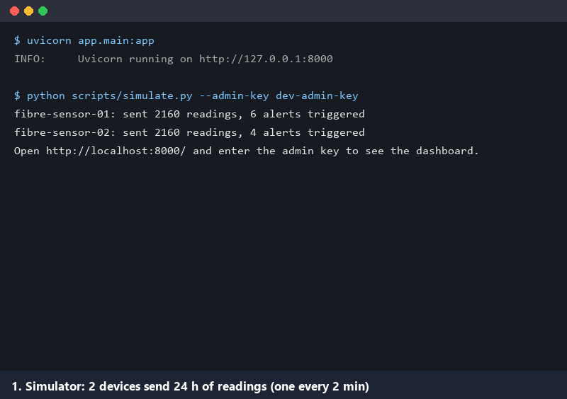

# SensorStream

[](https://github.com/Baswarajkotte/sensorstream/actions/workflows/ci.yml)


A backend for IoT sensor data. Devices push batches of readings over a REST API, threshold rules
raise alerts as data arrives, and a pandas analytics layer serves bucketed statistics, rolling
z-score anomaly detection and CSV exports. A small dashboard shows it all in the browser.



## Features

- **Per-device API keys**: each device gets its own key (stored as a SHA-256 hash, shown once, rotatable)
- **Batch ingestion**: up to 1,000 readings per request, validated with Pydantic (metric names, finite values, UTC timestamps)
- **Threshold alerts**: global or per-device `gt` / `lt` rules evaluated on every batch, with acknowledge workflow
- **Time-series analytics (pandas)**: resample into 1 min to 1 day buckets with count / mean / min / max
- **Anomaly detection**: rolling z-score against the *previous* N readings, so a spike cannot hide itself in its own baseline
- **CSV export** for reporting and offline analysis
- **Dashboard**: a static page using Chart.js, served by the API
- **Device simulator**: generates 24 h of realistic readings with daily cycles, noise and injected faults
- **Production setup**: SQLAlchemy 2.0 with a composite `(device, metric, time)` index, PostgreSQL via Docker Compose, GitHub Actions CI, 19 pytest tests

## Architecture

```
IoT device ──X-API-Key──▶ POST /ingest ──▶ validate ──▶ readings table
                                              └──▶ alert rules ──▶ alerts table

Operator ──admin key──▶ /devices  /rules  /alerts
                        /devices/{id}/stats      ─┐
                        /devices/{id}/anomalies  ─┼─ pandas (resample, rolling z-score)
                        /devices/{id}/export.csv ─┘
```

```
app/
├── main.py              # FastAPI app, dashboard route
├── config.py            # settings from environment / .env
├── database.py          # SQLAlchemy engine and session
├── models.py            # Device, Reading, AlertRule, Alert
├── schemas.py           # Pydantic validation
├── security.py          # admin key and per-device key auth
├── routers/             # devices, ingest, analytics
├── services/
│   ├── analytics.py     # bucket stats, anomaly detection
│   └── alerts.py        # threshold rule evaluation
└── static/dashboard.html
scripts/simulate.py      # sends simulated sensor data
```

## Run it

**Locally (SQLite):**

```bash
python -m venv .venv
source .venv/bin/activate          # Windows: .venv\Scripts\activate
pip install -r requirements.txt
uvicorn app.main:app --reload
```

In a second terminal, load 24 hours of simulated data:

```bash
python scripts/simulate.py --url http://localhost:8000 --admin-key dev-admin-key
```

Then open http://localhost:8000/ (dashboard, enter `dev-admin-key`) or http://localhost:8000/docs (Swagger UI).

**With Docker (PostgreSQL):**

```bash
docker compose up --build
```

## Example

```bash
# Register a device (admin)
curl -X POST localhost:8000/devices -H "X-API-Key: dev-admin-key" \
     -H "Content-Type: application/json" -d '{"name":"boiler-01","location":"Plant 2"}'
# -> {"id":1, "name":"boiler-01", ..., "api_key":"dev_..."}

# Alert when temperature goes above 80
curl -X POST localhost:8000/rules -H "X-API-Key: dev-admin-key" \
     -H "Content-Type: application/json" -d '{"metric":"temperature_c","operator":"gt","threshold":80}'

# The device sends readings with its own key
curl -X POST localhost:8000/ingest -H "X-API-Key: dev_..." -H "Content-Type: application/json" \
     -d '{"readings":[{"metric":"temperature_c","value":72.4},{"metric":"temperature_c","value":85.1}]}'
# -> {"accepted":2, "alerts_triggered":1}

# Hourly stats and anomalies
curl "localhost:8000/devices/1/stats?metric=temperature_c&bucket=1h&hours=24" -H "X-API-Key: dev-admin-key"
curl "localhost:8000/devices/1/anomalies?metric=temperature_c&window=20&threshold=3" -H "X-API-Key: dev-admin-key"
```

## API

| Method | Path | Auth | Description |
|--------|------|------|-------------|
| POST | `/devices` | admin | Register a device, returns its API key once |
| GET | `/devices` | admin | List devices with last-seen time |
| POST | `/devices/{id}/rotate-key` | admin | Issue a new key, revoke the old one |
| DELETE | `/devices/{id}` | admin | Remove a device and its data |
| POST | `/ingest` | device | Send a batch of readings |
| GET | `/devices/{id}/metrics` | admin | Metrics this device reports |
| GET | `/devices/{id}/stats` | admin | Bucketed count / mean / min / max |
| GET | `/devices/{id}/anomalies` | admin | Rolling z-score anomalies |
| GET | `/devices/{id}/export.csv` | admin | CSV download |
| POST / GET / DELETE | `/rules` | admin | Manage threshold rules |
| GET | `/alerts` | admin | List alerts (filter by device / unacknowledged) |
| POST | `/alerts/{id}/ack` | admin | Acknowledge an alert |

## How anomaly detection works

For each reading, the baseline is the mean and standard deviation of the previous `window`
readings. The z-score is `(value - mean) / std`. A reading is flagged when `|z| >= threshold`
(3 by default). The baseline uses `shift(1)` so the reading being tested is never part of its
own baseline, and a perfectly flat baseline still flags any change.

## Tests

```bash
pytest -v
```

Tests cover admin and device authentication, key rotation, payload validation, alert rules,
bucketed stats, anomaly detection (spikes, drops, flat baselines, edge cases) and CSV export.

## Author

**Kotte Baswaraj**, Python Backend Developer · [LinkedIn](https://linkedin.com/in/kotte-baswaraj)
